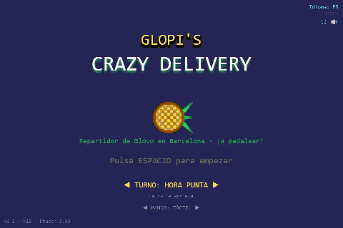

# 🍍 Glopi's Crazy Delivery

Glopi, a pineapple, works as a Glovo delivery rider in Barcelona on a bicycle.
Crazy Taxi–style arcade delivery: accept orders, chain pickups, deliver before the fare timer runs out, and rack up near-miss bonuses in traffic.



**Play it now:** <https://mariodod.github.io/glopi-crazy-delivery/>  *(game at /juego/, no install)*

Full design document & milestones: [PLAN.md](PLAN.md)

## Tech

- JavaScript + [Phaser 3](https://phaser.io/) via ESM import map — zero npm deps, zero build step
- Tiled tilemaps, pixel-art assets, Web Audio chiptune loops
- ES / CA / EN UI (`src/i18n.js`), three difficulty tiers (`src/data/difficulties.js`)
- Keyboard, gamepad or on-screen touch controls; shift ends with a rider-rank career card

## Run (dev)

```bash
npm start          # static server on http://localhost:3000 (zero-dep, tools/serve.mjs)
```

## Web export (GitHub Pages)

```bash
node tools/build.mjs      # assembles dist/ (landing + juego/ + promo/)
```
Deploy = push `dist/` to the `gh-pages` branch (orphan committed via a worktree).

## Asset pipeline

```bash
npm run gen        # regenerate city.png, landmarks.png and barcelona.json (deterministic)
```

The whole pipeline is dependency-free: `tools/gen-*.mjs` write real PNGs and
Tiled-format JSON with a tiny in-repo PNG encoder, so art and map stay in-sync
with the game at zero cost. `tools/gif-encoder.js` does the same for the
gameplay GIF (`promo/gameplay.gif`); `tools/verify-gif.mjs` re-decodes it.

## Controls

| Action | Key |
|---|---|
| Pedal | `W` / `↑` / pedal button (touch) |
| Brake | `S` / `↓` / brake button (touch) |
| Steer | `A` `D` / `←` `→` / steer pads (touch) |
| Accept/interact | `SPACE` |
| Bell | `SHIFT` |
| Language | `L` |
| Mute · fullscreen | 🔇 / ⛶ buttons (menu + HUD) |
| Pause | `ESC` |

## License

Game code MIT. Assets © their authors. Glopi is our own pineapple — any resemblance to real couriers is pure traffic luck.
